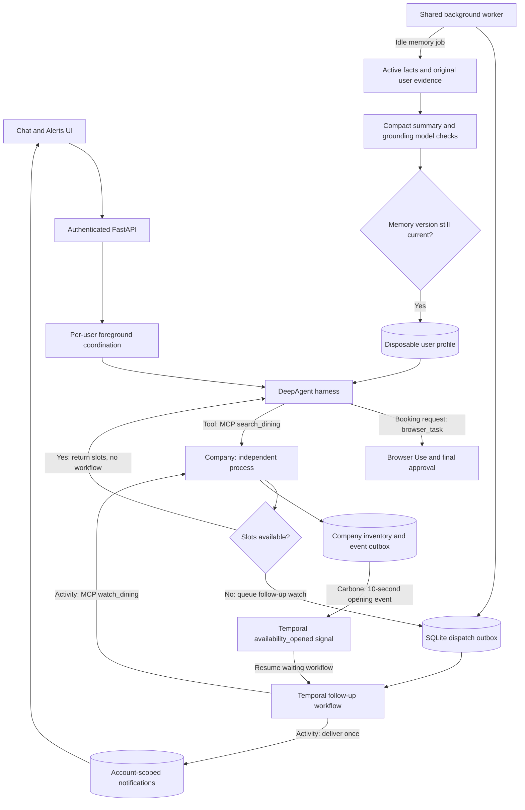

# Architecture

The browser UI sends authenticated requests to FastAPI, which coordinates a per-user agent and SQLite storage.

While a same-chat run is running/resuming, additional messages and draft attachments are saved to `run_followups` and return the existing run ID. A model-boundary yield lets the service append a combined request to the same LangGraph checkpoint, preserving completed tools. The router receives original messages, additions and tool outcomes and classifies outstanding work. Latest corrections take precedence. A finalizer also drains updates arriving during summary persistence. The UI handles `response_reset` when a partial answer is superseded. Stop/New Chat and browser input/approval controls retain their separate behavior; new instructions cannot authorize an older pending action.

Travel requests distinguish exploration, comparison, concrete availability, preparation and execution. Main-agent research handles loose destination/date discovery before strict inventory validation. `personal_agent/travel_planning.py` owns typed, versioned chat drafts in the application database, separating confirmed user constraints from provisional assumptions and sourced options. The service loads that draft each turn; routing decides whether the current message concerns it. Drafts respect account ownership, context floors and source exclusions and never write long-term facts. Preparation reuses existing research, shopping and guarded browser tools.

Travel comparisons enforce `watch_policy=observe_only` through the gateway and task envelope. Workflow starts, schedules and watch registration reject that policy; ordinary concrete availability and explicit monitoring retain their existing behavior. Run events record travel intent, draft updates/errors and response metrics. Clarification-only detection is a heuristic; time to first options measures a saved candidate update rather than browser rendering latency.

Dining and travel use the independent services described in [Dining and Travel Subagents](availability-subagents.md), including the current sequence diagram, ports, webhook contracts, shared-state ownership and user-configured Temporal Schedules (five-minute default, one-minute minimum). The dining-only flow below describes retained compatibility workers for earlier executions; new requests use `delegate_dining`/`delegate_travel`, subagent DeepAgent MCP searches, and signed subagent webhooks.

| Component | Responsibility |
| --- | --- |
| `manage.py` | Manual HTTPS startup, shutdown, TLS fingerprint checks and Keychain loading |
| `personal_agent/app.py` | Authentication, API routes, attachment upload and live browser controls |
| `service.py` | User locks, task lifecycle, context, streaming, cancellation, and memory scheduling |
| `agent.py` | DeepAgents graph, research routing, web search and model/tool limits |
| `db.py` / `memory.py` | SQLite persistence, summaries, preferences, correction and forgetting |
| `background.py` | Idle memory worker, leased Temporal dispatch jobs and account-scoped alert status |
| `availability/` | Main delegation gateway, dining/travel DeepAgents, shared scoped state, signed webhook inboxes, Company inventories and Temporal schedules/workflows |
| `dining.py` / `dining_workflow.py` | Compatibility worker and activities for previously started dining workflows |
| `dining_company/` | Independent Company MCP server, its own inventory database and durable event outbox |
| `dining_stack.py` | Lifecycle for three Company services, two subagents and persistent local Temporal |
| `memory_profile.py` | Evidence-based idle consolidation, independent grounding check and version-checked derived profiles |
| `attachments.py` | Owned file metadata and bounded image input for model calls |
| `illustrations.py` | Main-agent image generation/editing, independent visual verification, bounded correction and private scene/image storage |
| `browser_tasks.py` | Worker supervision, approval receipts, duplicate protection and independent verification |
| `browser_policy.py` | Shared PoC/strict profiles for target-aware actuation, prompts, provider transitions and execution/recovery bounds |
| `browser_verification.py` | Deterministic evidence for explicit page-opening goals before independent model verification |
| `browser_use_worker.py` | Isolated Browser Use perception/planning and guarded action execution |
| `browser_host.py` / `browser_control.py` | Per-user Headless/Visible selection, separate saved profiles, native networking without request interception, and shared streaming/manual control; Visible follows native window dimensions without viewport emulation |
| `chrome_runtime.py` | Minimal installed-Chrome startup for Visible mode, loopback connection readiness and owned-process shutdown; preserves normal Chrome storage handling |
| `sources.py` | Source policy, domain constraints, provenance labels and safe link handling |
| `static/` | Chat rendering, composer attachments, streaming and takeover UI |
| `tunnel.py` | Optional ngrok lifecycle; public tunnel settings were not changed in maintenance |

## Retained dining workflow compatibility

All ordinary chat requests enter DeepAgent. A model-based router distinguishes dining availability from general recommendations and web research. The initial Company lookup runs as an agent tool, not a Temporal activity. Missing details return to the agent for clarification. Company errors do not create watches or imply unavailability. Only an accepted unavailable result queues Temporal, using a durable SQLite outbox and stable workflow ID. Its registration activity starts Company's event subscription; the workflow then waits for a signal. Available results never start a workflow. Form submissions also enter the same agent path.

Booking execution is a separate intent, including short follow-ups after an opening. These runs use Browser Use; the Company availability tool is hidden and also rejects invocation if attempted. This prevents a booking follow-up from rechecking Company and generating a second watch. Browser execution retains its approval and outcome-verification boundaries.

Temporal records registration and delivery activity results and waits durably for a Company signal; it does not run Aster-side availability timers. Company owns inventory behavior and retains undelivered events in its separate database. Legacy signals can arrive while Aster's worker is stopped; replay resumes the workflow when it returns. New events use subagent webhooks and the `SubagentWatch` / `MainAvailability` workflows. Criteria correlation, watch ownership, status and delivery deduplication guard notification delivery. Cancelling a watch prevents a late notification. Legacy workflow/activity names remain registered to drain existing executions without breaking replay.

Company and Temporal have independent lifecycles and remain running when Aster stops. Memory maintenance stays inside Aster, yields to foreground activity, and discards results if source memories change during model calls. No per-user resident model session is required.

Research never authorizes a transaction. Independent-source mode is read-only context, not permission to change browser scope or act on an account. The browser worker's approval, ownership, and uncertain-outcome protections apply independently of model reasoning and retries.

SDK retries are confined to model inference requests. They do not rerun service tasks, tool handlers, browser clicks or submissions. A stream failure after output has started remains explicit.

All accounts, chats, files, Keychain credentials, certificates, browser profiles and logins remain local/private. `.runtime/` is not source code. Saved browser profiles and the optional public tunnel need separate operational access controls.
