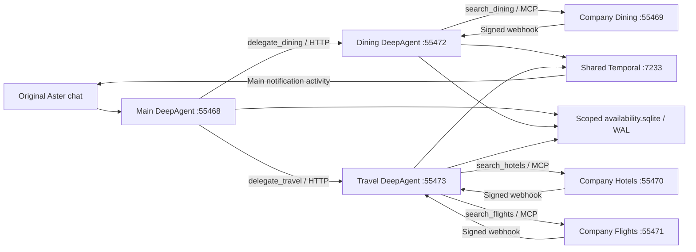
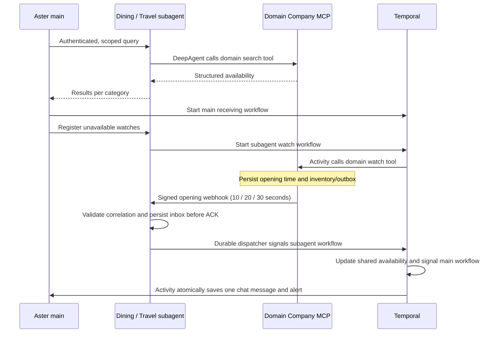

# Dining and travel availability

Aster delegates dining to an independent Dining DeepAgent and hotels/flights to an independent Travel DeepAgent. All three harnesses use GPT-5.4 mini. General-purpose and nested DeepAgents subagents are disabled in their harness profiles. Browsing, bookings and unrelated work stay in the main harness; Company does not book.

Both subagents also expose a read-only `web_search` tool backed by OpenAI Responses web search. Generic dining/hotel/flight queries discover sourced candidates, then call Company MCP with those exact venue/property names or airline/connection criteria. Candidate results include their Company check and research citations in one record. Star constraints are preserved. Failed or unmatched discovery produces an explicit gap rather than a generic hotel/default airline. A query can also set `research: true` for a named venue, property or airline. Web snippets never establish availability.

Discovery results contain scoped child query IDs and `candidate_results` underneath the original query result, preserving the API's one-result-per-input contract. Watches and notifications use the unavailable child IDs, including mixed lists where another candidate is already available. Recurring monitors retain their candidate set and refresh those Company checks without restarting opening timers. Unchanged observations and opening callbacks share main-owned delivery deduplication.

For day-by-day requests, main calls `compose_trip` after delegations. The composer validates each date, checks dining names against Company results for that date, verifies attraction citations, preserves round-trip dates and prevents destination activities before arrival. Budget totals combine returned Company fares/room prices with explicitly labeled dining/activity/transport estimates. Gaps return to the harness for targeted checks or research; raw research lists are not appended as a second recommendation section.

Main entertainment research searches tourism/attraction sites and established travel publishers broadly, then extracts named attractions with original evidence quotations, cited HTTPS URLs and suitable day periods. Other main research retains its explicit publisher-domain scope. The composer allocates concrete records across dates, excluding travel/transfer windows; generic headings and tourism navigation labels cannot become attractions. It requests more research when a daily period has no supported activity instead of filling the stay with repeated museum labels. Markdown-table evidence is supported without rewriting quotations. Dining continues to use separately checked meal records and venue-diversity constraints.

Company flight clocks are configured inventory, not airline timetables: durations depend on route distance and connections, with IANA timezones for configured cities and UTC clocks for unconfigured locations. City/IATA aliases collapse into a single stop; distinct airports remain distinct. In an itinerary, Travel checks flights before aligning hotel check-in to destination arrival, unless the user explicitly supplies check-in. Main validates that exact adjustment and rejects changes to other criteria. Ordinary standalone hotel searches retain their supplied dates.

Budget parsing preserves symbols and currency codes. Non-USD totals use the ECB daily reference feed when it supports both currencies, retaining the rate date and source in the plan. Prices are converted rather than relabeled. Missing conversion data remains an internal composition gap; prices in different currencies are never silently summed.

Pending and recent criteria are loaded from user/chat-scoped structured task records. The router receives this state for short replies and corrections. Main binds explicit replies such as `1 room`, `From Phoenix`, cabin changes and ISO checkout corrections before delegation, retaining the other supplied criteria. Explicit counts are grounded in the current user text or scoped earlier input; omitted counts use the defaults below. Clearing chat context excludes older criteria.

When omitted after applying relevant trip context, hotel occupancy defaults to two guests in one room, flight passengers to two, and dining party size to two. Dining defaults to today's date in the configured user timezone. Hotel check-in defaults to tomorrow, and missing checkout defaults to the day after the effective check-in. Explicit dates/counts are retained; combined hotel/flight requests inherit matching travel dates before defaults apply. Flight dates, route, cabin and venue/destination details still require input when genuinely missing. Generic request words such as “flights” cannot bind as named hotel targets.



## Requests and openings

The main harness creates ownership/correlation envelopes. Tool arguments contain only criteria and optional explicit monitoring requests. Internal bearer authentication and per-domain HMAC signatures are stored in the ignored, mode-0600 `.runtime/availability-secrets.json`. All services bind to loopback. Callbacks are fixed in Company configuration, never model-selected.

Subagents expose `POST /v1/availability/query`, `GET /v1/requests/{id}`, `POST /v1/watches`, `POST /v1/watches/{id}/cancel`, and `/health`. Each query returns `completed`, `needs_input`, or `error`. Successful options include their Company provenance and check time. The travel harness can invoke hotel and flight search tools concurrently; a missing or failed category does not hide a successful independent category.



Company's only initially unavailable resources are Carbone in New York (10 seconds), The Fifth Avenue Hotel in New York (20 seconds), and Emirates first class to Dubai (30 seconds). Timers begin at watch acceptance. Inventory, opening transitions and undelivered callbacks survive restarts. Further searches for the same logical request/monitor retain the opened state. Cancellation gates delivery independently of the Company's callback timing.

Repeated checks in the same chat reuse main-generated query IDs, including supported resource/city/cabin aliases. Cancelling a watch gives a subsequent fresh request a new identity. Notification deduplication uses the main application's event ledger in the same transaction as chat and alerts, so loss of a cache update cannot duplicate a delivered message.

## Trip itineraries

Trip itineraries carry scoped destination, date-range and traveler-count context. Dining expands that context into breakfast, lunch and dinner checks without asking for separate meal dates. Discovery is shared across dates within each meal, while Company checks every date/meal individually and returns meal-specific slots. The main planner receives compact coverage; full results and citations remain in the shared store.

Dining-only follow-ups such as “in Paris between those days, for lunch and dinner” also resolve the full range from the same user's same-chat travel records after the context floor. They expand only the requested meals across all dates, retain the known party size, and do not turn the request into a full travel itinerary. A 19-day lunch/dinner follow-up therefore performs 38 Company meal checks.

Hotel and flight discovery counts are grounded in the originating user message separately for each category. Unspecified counts are sampled from four to seven once per run and remain stable through retries. Explicit counts are honored through extraction and Company checks, with bounded supplemental research for larger lists; a verified shortfall is stated rather than filled with invented options. Star ratings, rooms and passenger counts are not list lengths.

Venue options and concrete item recommendations use compact preview rows: a small photo, a clickable name, and one short description. Public source pages must match the item/venue before their published image is used. Raster photos are size-bounded, cached under `.runtime/venue-photos/`, and served through authenticated `/api/venue-photos/{key}` URLs; the existing self-only image CSP remains unchanged. Missing photos produce a neutral fallback. Metadata is presentation only and is excluded from availability-change deduplication. Personalized shopping prose stays in the user's chat instead of the shared public-image cache. Retail recommendations stay with the main agent; no shopping subagent was added.

The itinerary composer fills meals from checked results, excludes meals before arrival or close to departure, and explicitly renders breakfast, lunch, dinner and entertainment sections. It prefers different venues across meal types and rejects plans containing more than two visits to one venue. Repeat repairs target only the affected meals. Entertainment is researched by the main harness separately from dining; no new subagent is introduced.

## Monitoring

Only an explicit user request creates a native Temporal Schedule. The main agent immediately checks the valid requested categories, then checks at the interval requested in the originating user message using the same HTTP/DeepAgent/MCP path. The default is five minutes when unspecified; all intervals have a one-minute minimum. The saved cadence drives both Temporal and the displayed acknowledgement/panel. Existing schedules without cadence metadata recover it from their owned originating message and are updated in place. An unavailable one-off request creates an opening watch only. An opening does not stop an explicit monitor.

Schedules use `SKIP` overlap, a five-minute catch-up window, a two-minute execution bound, and an end date. Earlier user deadlines take precedence. Unchanged results stay quiet; changes, failures, recovery and needed input appear in the original chat. The background panel shows status, last check, next check and cancellation controls. Main owns all chat and alert writes. Dismissal marks alerts read without deleting chat messages.

## Storage and restart compatibility

- `.runtime/availability.sqlite`: scoped requests, snapshots, subscriptions, monitor references, webhook inbox, delivery outbox and notification deduplication. No agent reads Temporal's internal database.
- `.runtime/checkpoints.sqlite`: main checkpoints; `dining-checkpoints.sqlite` and `travel-checkpoints.sqlite`: independent subagent checkpoints, scoped by role/user/chat/request/execution.
- `.runtime/company/*-inventory.sqlite`: independent Company inventory and webhook outboxes.
- `.runtime/application.sqlite`: main-owned chat, alerts, authoritative delivery deduplication and compatibility projections. Existing table names and foreign keys remain intact.
- `.runtime/temporal.sqlite`: owned exclusively by Temporal. Main queue `aster-main-v3`; subagent queues `aster-dining-v3` and `aster-travel-v3`. Legacy queue `aster-dining` retains `DiningWorkflow`, `DiningWatchWorkflow`, and their activity names to drain earlier executions.

## Local operation

Use `.venv/bin/python dining_stack.py start` to start dependencies in order; `status` reports readiness. The stack starts Temporal (7233, UI 8233), three Company services (55469–55471), and the two subagents (55472–55473). `manage.py start` also starts dependencies before Aster. Provider credentials enter subagents through a private pipe; Company services receive no model key.

Main startup checks subagent readiness. A failed subagent produces an availability error, never a direct Company fallback. Stopping main leaves companions running. After changing companion code, restart the stack explicitly with `dining_stack.py stop` then `start`; databases and pending Temporal histories are retained. Restart Aster with `manage.py stop` then `start`. Public tunnel and login behavior are unchanged.

Validation:

```sh
.venv/bin/python -m pytest -q
RUN_AVAILABILITY_TESTS=1 RUN_DINING_TESTS=1 .venv/bin/python -m pytest -q tests/test_availability_temporal.py tests/test_dining_temporal.py
.venv/bin/python -m validation.travel_matrix
```

The new integration test runs actual local MCP and HTTP services, DeepAgent harnesses, signed webhooks and Temporal workers against isolated databases. It verifies all three delays, main-worker downtime, duplicate delivery, native schedule configuration and execution, scoped APIs, cancellation and late-event suppression. Legacy dining integration remains separate to verify pending-work compatibility.

`validation.travel_matrix` uses actual GPT-5.4 mini main/subagent harnesses and live web searches, with isolated local Company/Temporal services and a temporary main database. It exercises Dubai room-count follow-up, Paris origin/cabin follow-up, Tokyo guest/room/date corrections, combined hotel/flight queries, a complete ten-day Dubai itinerary, unrelated conversation, and explicit monitoring/cancellation. It also checks both subagents' named-resource web searches. The detailed report is saved to `.runtime/travel-evaluation.json`; no real user's chats, browser or bookings are changed. Use `--itinerary` to repeat only the full trip, producing `.runtime/itinerary-evaluation.json`.

Generic discovery cannot be bypassed by a main-model shortlist: only user-named resources skip discovery. Flight extraction preserves connecting routes, rejects alternative hubs concatenated into one route, and rejects mixed-cabin evidence for a cabin-specific request. Recurring checks retain previously verified candidates while refreshing their Company inventory.

`validation.travel_matrix --defaults` repeats the combined LA–Paris regression and omitted occupancy/date prompts through the real main/subagent models and local Company MCP. Its report is `.runtime/availability-defaults-evaluation.json`.
