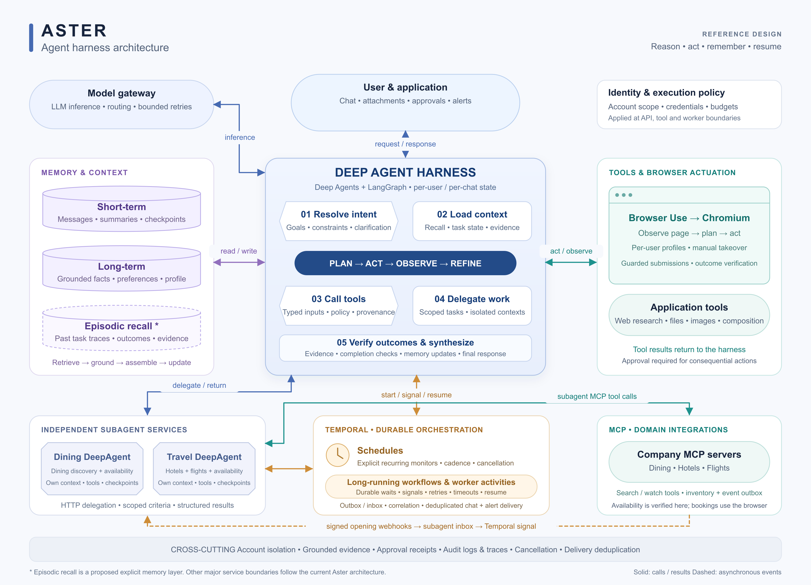

# Aster architecture diagram

[Editable vector diagram](aster-architecture.svg)

This reference design combines Aster's documented service boundaries with an explicit proposed episodic-recall layer. It is a conceptual architecture, not a deployment or exhaustive data-flow diagram.

The central Deep Agent harness resolves intent, assembles context, plans, calls tools, delegates work, verifies outcomes and synthesizes responses. FastAPI and service coordination prepare authenticated, account-scoped requests; some context assembly and verification occur in these deterministic application layers around the agent loop.

Short-term memory includes messages, summaries and LangGraph checkpoints. Long-term memory includes grounded user facts, preferences and derived profiles. Episodic recall of task traces and outcomes is shown as a proposed extension, not a claim that Aster has a dedicated episodic memory backend today. The cylinders indicate logical memory categories, not necessarily separate databases.

Dining and Travel are independent DeepAgent services with their own checkpoints. They call Company MCP servers. Signed Company opening webhooks reach the subagent inboxes, which dispatch Temporal signals. Temporal owns schedules, durable waits, workflow histories, activity retries and resumption. Aster retains application state and delivery deduplication separately from Temporal's internal state. Workflow durability does not imply arbitrary browser actions can be replayed safely: browser execution remains guarded by approval receipts, duplicate protections and outcome verification.

The current documented durable workflows cover availability watches and recurring monitors. The Temporal block also expresses the intended architectural boundary for future long-running processes. Current memory consolidation runs in Aster's background worker rather than a Temporal schedule. The model gateway represents the configured inference boundary, not a separate deployed gateway service. Approval and execution policy apply across application and worker boundaries.

## Design references

- [Aster architecture](../ARCHITECTURE.md)
- [Aster availability subagents and Temporal](../availability-subagents.md)
- [LangChain: The Anatomy of an Agent Harness](https://www.langchain.com/blog/the-anatomy-of-an-agent-harness)
- [LangChain: Browser Use in Managed Deep Agents](https://www.langchain.com/blog/browser-use-in-managed-deep-agents)
- [Anthropic: How we built our multi-agent research system](https://www.anthropic.com/research/multi-agent-research-system)
- [Temporal: Building long-running interactive MCP tools](https://temporal.io/blog/building-long-running-interactive-mcp-tools-temporal)
- [Manus: Context engineering for AI agents](https://www.manus.im/blog/Context-Engineering-for-AI-Agents-Lessons-from-Building-Manus)

## Request execution sequence

[PNG diagram](aster-sequence.png) · [Editable SVG](aster-sequence.svg) · [Mermaid source](aster-sequence.mmd)

The sequence groups a normal request into scoped planning, relevant execution paths, verified streaming output, and optional durable availability work. The outlined paths are conditional, rather than mandatory stages. Context is loaded before detailed intent resolution; the architecture’s numbered capabilities are not a strict runtime ordering. Inference is implicit within agent steps, with model duties listed below the visual. Episodic recall remains proposed. Browser actions retain approval and verification boundaries and are not automatically replayed by Temporal.
